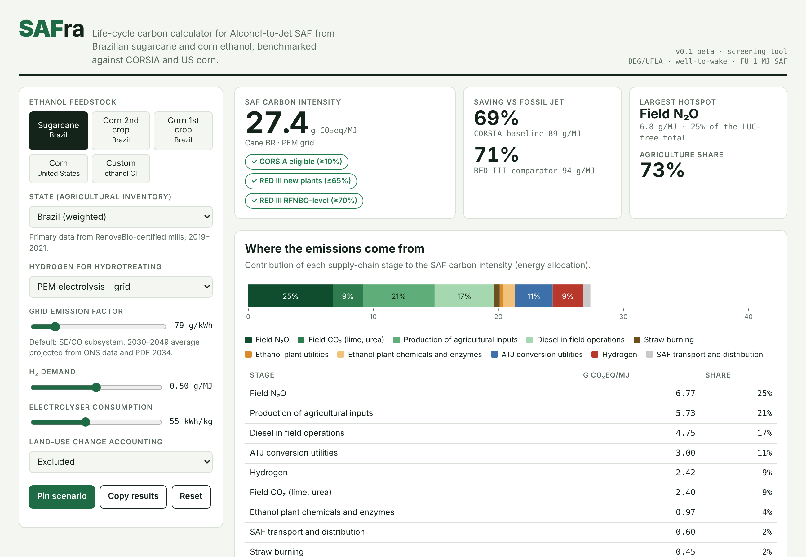
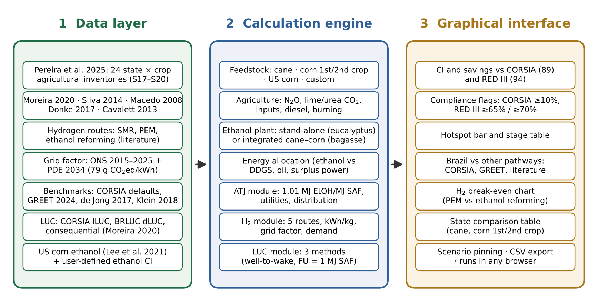

# SAFra – life-cycle carbon calculator for Alcohol-to-Jet SAF

[](https://doi.org/10.5281/zenodo.23819362) [](https://biochainplatform.github.io/safra/) [](LICENSE)

**SAFra** (*SAF* + *safra*, Portuguese for "harvest") is a free, browser-based tool that estimates the well-to-wake carbon intensity (CI) of Alcohol-to-Jet (ATJ) sustainable aviation fuel produced from Brazilian sugarcane and corn ethanol, and compares it with US corn pathways, CORSIA default values and published ATJ life cycle assessments.

**Live tool:** https://biochainplatform.github.io/safra/



> **Screening use only.** SAFra gives indicative values for research, teaching and pre-feasibility studies. It does not replace a certified CORSIA, RED III or RenovaBio calculation.

---

## What it does

| Inputs | Outputs |
|---|---|
| Feedstock: sugarcane, first- or second-crop corn (Brazil), US corn, or a user-defined ethanol CI | SAF CI (g CO₂eq/MJ) and savings vs CORSIA (89) and RED III (94) fossil references |
| State: 24 state-level agricultural inventories (7 cane, 9 second-crop corn, 8 first-crop corn) | Threshold flags: CORSIA ≥10%, RED III ≥65% / ≥70% |
| Ethanol plant: stand-alone (eucalyptus CHP) or integrated cane–corn (bagasse CHP) | Stage-by-stage hotspot chart and table |
| Hydrogen: PEM (grid, bagasse power, wind), ethanol steam reforming, natural gas SMR | Benchmark chart against CORSIA defaults, R&D GREET and literature |
| Grid emission factor, electrolyser consumption, H₂ demand | Hydrogen break-even chart (PEM vs ethanol reforming) |
| Land-use change: excluded, CORSIA ILUC, BRLUC dLUC, consequential | State comparison table, scenario pinning, CSV export |



## Key results (default settings, LUC excluded)

| Pathway | CI (g CO₂eq/MJ SAF) |
|---|---|
| Sugarcane, Brazil average, integrated mill, PEM grid H₂ | 27.4 |
| Second-crop corn, Brazil average, integrated cane–corn mill, PEM grid H₂ | 25.1 |
| Second-crop corn, Brazil average, stand-alone mill, PEM grid H₂ | 26.7 |
| US corn ethanol, NG SMR H₂ (consistency check vs CORSIA 54.1) | 54.6 |

## Run it

SAFra is a single static HTML file with no build step and no server code.

- **Online:** open the GitHub Pages address above.
- **Offline:** download `index.html` and open it in any modern browser (fonts fall back to system fonts without internet).

## Publish your own copy with GitHub Pages

1. Create a public repository named `safra` and upload the contents of this folder (keep `.nojekyll`).
2. Go to **Settings → Pages**, choose **Deploy from a branch**, branch `main`, folder `/ (root)`, and save.
3. After about a minute the tool is live at `https://biochainplatform.github.io/safra/`.
4. Optional: add a custom domain (e.g. `safra.example.org`) in the same Pages settings.

## Archive and cite (Zenodo DOI)

1. Log in to [Zenodo](https://zenodo.org) with GitHub and switch on the `safra` repository under **GitHub → Repositories**.
2. Create a GitHub release (e.g. `v0.1.0`). Zenodo archives it and mints a DOI automatically, using `.zenodo.json` and `CITATION.cff`.
3. Add the DOI badge to this README and cite it in papers.

## Repository contents

```
index.html                          the tool (HTML + CSS + JavaScript, single file)
data/agricultural_inventories_pereira2025.csv   state-level agricultural emissions by category
data/model_parameters.csv           all model parameters with units and sources
data/benchmarks.csv                 CORSIA defaults and literature values used in the benchmark chart
docs/METHODOLOGY.md                 equations, system boundary and assumptions
docs/img/                           screenshots and architecture figure
CITATION.cff, .zenodo.json          citation metadata
LICENSE                             MIT licence (code)
LICENSE-DATA.md                     CC BY 4.0 (data compilation) and original-source attribution
CHANGELOG.md                        version history
```

## Roadmap

- 2G (bagasse/straw) ethanol and fermentation-CO₂ capture (BECCS)
- Monte Carlo uncertainty using the percentile ranges of Pereira et al. (2025)
- Cost indicators (minimum SAF selling price)
- Other ethanol pathways (EU wheat and sugar beet, Indian molasses)
- Portuguese and Spanish interface

## Team

Developed at the Department of Engineering (DEG), Federal University of Lavras (UFLA), Brazil, in collaboration with the Federal University of ABC (UFABC) and the University of Zaragoza.

Contact: Prof. Adriano Viana Ensinas – adriano.ensinas@ufla.br

## How to cite

> Ensinas, A. V. et al. (2026). *SAFra: life-cycle carbon calculator for Alcohol-to-Jet SAF from Brazilian ethanol* (v0.1.0) [Software]. Zenodo. https://doi.org/10.5281/zenodo.23819362

---

### Resumo em português

O **SAFra** é uma ferramenta gratuita, executada no navegador, que estima a intensidade de carbono do SAF produzido pela rota Alcohol-to-Jet a partir de etanol de cana e de milho brasileiros, por estado, configuração de usina, rota de hidrogênio e método de mudança de uso da terra, e a compara com o milho norte-americano, os valores default do CORSIA e a literatura. Uso apenas para triagem; não substitui cálculos certificados (CORSIA, RED III, RenovaBio).
